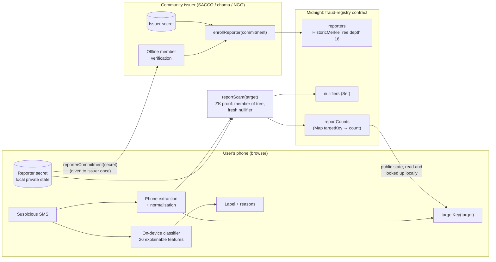

# ScamShield — Funding Application Draft

> **Status of this document:** a draft for the founder to adapt and paste into
> an application form. Every **[TODO: …]** is a placeholder the founder must
> fill in or confirm. Every claim about the code below points to a file in
> this repository and was checked against it. Every statistic links to its
> source. Nothing here has been invented. If a figure could not be verified,
> it was left out.

---

## 1. Summary

**One-liner:** ScamShield is open-source fraud protection for mobile-money
users. It has two parts. A scam-message checker runs entirely on the phone, so
the message never leaves the device. A community scam-number registry
records reports anonymously and limits each member to one report per number,
which makes it hard to flood with fake reports (Sybil-resistant). The registry
runs on the Midnight zero-knowledge blockchain.

**Summary paragraph:** Mobile money is how most Kenyans pay, save and send
support to family. It is also where they are defrauded, through fake M-Pesa
confirmations, "sent by mistake, please reverse" scripts, fake prize and loan
offers, and PIN phishing. ScamShield gives people two tools. The first is an
**on-device, explainable scam-message checker** for English, Swahili and Sheng.
It runs in the browser with no network calls and tells the user *why* a
message looks like a scam. The second is an **anonymous community scam
registry** on Midnight. Trusted community organisations (SACCOs, chamas, NGOs)
verify their members offline and enroll them. A member can then report a
scammer's number with a zero-knowledge proof that shows "I am an enrolled
member who has not reported this number before" without revealing *which*
member they are. Anyone will be able to look up how many verified reports a
number has before sending money (wallet-free lookup is Milestone 1). The detector and the contract are built and tested in
this repository. The registry has **not** been deployed to a public network
yet. We are applying for a **grant (public-goods track)** to take it from a
tested prototype to a field pilot with community organisations in Kenya.

---

## 2. Problem

### Mobile money is how much of the region pays

- Kenya had **54.0 million mobile money subscriptions** as of 30 June 2026, a
  penetration rate of **101.3%**. Safaricom (M-Pesa) held **88.8%** of the
  mobile money market.
  ([Communications Authority of Kenya, Q4 FY2025/26 Sector Statistics Report](https://www.ca.go.ke/sites/default/files/2026-09/Sector%20Statistics%20Report%20Q4%202025-2026.pdf))
- Safaricom reports **40.99 million one-month-active M-PESA customers** in
  Kenya for the year ended 31 March 2026.
  ([Safaricom FY26 Results Booklet](https://www.safaricom.co.ke/images/Downloads/FY26-Earnings-Booklet-2026-7th-May-2026.pdf))
- **52.6% of Kenyan adults use mobile money daily**, up from 23.6% in 2021.
  ([2024 FinAccess Household Survey, CBK / KNBS / FSD Kenya](https://www.centralbank.go.ke/wp-content/uploads/2024/12/2024-FINACCESS-HOUSEHOLD-SURVEY-MAIN-REPORT.pdf))
- Across the wider region, East Africa had **537 million registered** and
  **193 million 30-day-active** mobile money accounts in 2025. Sub-Saharan
  Africa processed **$1.4 trillion** of the **$2.1 trillion** that went
  through mobile money worldwide.
  ([GSMA, State of the Industry Report on Mobile Money 2026](https://www.gsma.com/sotir/wp-content/plugins/plugin_gsma_sotir/reports/The-State-of-the-Industry-Report-2026_English.pdf))

### People lose money, and fraud is getting more complex

- **9.8% of mobile money users reported losing money** (FinAccess 2024,
  Figure 4.14). *Caveat:* this counts loss from all causes. The same survey
  attributes most mobile-money losses (70.0%) to accidental sending, so it is
  not a pure fraud figure.
  ([2024 FinAccess Household Survey](https://www.centralbank.go.ke/wp-content/uploads/2024/12/2024-FINACCESS-HOUSEHOLD-SURVEY-MAIN-REPORT.pdf))
- In April–June 2026 the Communications Authority of Kenya (CA) received
  **670 escalated consumer complaints**. **110** concerned digital financial
  services and mobile money, and **75** concerned cybercrime.
  ([CA press release, 6 Aug 2026](https://www.ca.go.ke/ca-resolves-82-cent-ict-consumer-complaints-network-quality-and-fraud-top-grievances))
  The same report counts **86 fraud-and-scam complaints**, up from 47 the
  quarter before.
  ([as reported by The Eastleigh Voice, quoting the CA Q4 FY2025/26 report](https://eastleighvoice.co.ke/news/387337/fraud-and-scam-complaints-surge-83-per-cent-amid-mobile-money-sim-swap-threats))
- In July–September 2026 the CA received **57 complaints on digital
  financial services and mobile money** and **47 on fraud and scams**. The CA
  says fraud is moving "from traditional fraudulent calls and text messages to
  more complex schemes involving phishing, impersonation, fake promotions,
  social engineering, fraudulent mobile money transactions and online
  marketplace scams."
  ([CA Consumer Complaints Report, Q1 FY2026/27](https://www.ca.go.ke/sites/default/files/2026-11/Consumer%20Complaints%20Report%20for%20Q1%20FY%202026-2027.pdf))
  *Caveat:* these count only complaints *escalated to the regulator* after a
  provider failed to resolve them. They show trends and the kinds of scams
  people face. They do not measure how often fraud happens.
- Safaricom's own guidance describes the scam scripts ScamShield targets.
  Fake M-PESA messages sent from a personal line ("a genuine M-PESA message is
  sent from M-PESA and not a customer's line"). Fake reversal requests ("Do not refund. Request the person calling to forward the message to 456 or to call Safaricom for assistance."). Requests for the M-PESA PIN. Fees
  demanded to "unlock prizes, loans, jobs". Safaricom asks customers to
  forward scam texts to **333** so the numbers can be blocked.
  ([Safaricom: Tips for staying safe](https://www.safaricom.co.ke/fraud-awareness/tips-tricks),
  [Safaricom: M-PESA fraud](https://www.safaricom.co.ke/fraud-awareness/m-pesa-fraud))

**[TODO: optionally add a short first-hand account from a community partner
(with consent), or local survey data you collect yourself. Do not add any
figure you cannot link to.]**

### The gap ScamShield fills

1. **Checking a message happens alone and too late.** A worried user has
   no quick, private way to ask "is this message a scam?" before acting. Most
   alternatives mean pasting the message into a cloud service or asking
   strangers on social media, and both expose personal and financial details.
2. **Reports go into the operator's system, and the public sees nothing.**
   Reporting to 333 helps the operator block numbers, but a user about to pay
   an unfamiliar number cannot check whether others have reported it.
3. **Open crowd-sourced blacklists are easy to abuse.** An open "report a
   number" website can be flooded by one person with many accounts, or used to
   defame a legitimate trader. If it identifies reporters, it also exposes
   them to retaliation. Reporters need **anonymity**, and the registry needs
   **one-person-one-report**. ScamShield provides both together.

---

## 3. Solution — ScamShield

### 3.1 On-device scam-message checker

The code is in [`demo/src/scamShield/classifier.ts`](./demo/src/scamShield/classifier.ts).

- **Runs entirely in the browser.** It has no dependencies, makes no network
  calls and sends no telemetry. The message never leaves the device.
- **Explainable.** It is a logistic model, `score = sigmoid(-3 + Σ weights of
  the features that fired)`, over **26 named, human-readable features**. Each
  feature has a plain-language explanation the UI can show the user. Examples:
  "Looks like an M-Pesa confirmation but was sent from a personal phone
  number", "Asks you to send … your PIN", "Asks you to reverse … ('rudisha')".
  Labels are `scam` (score ≥ 0.75), `suspicious` (≥ 0.40) and `likely-safe`.
- **Kenyan context.** It covers English, Swahili and Sheng. It has rules
  targeting fake M-Pesa confirmations, scored differently depending on whether the sender is
  `MPESA`, looks like another sender ID, is a contact name or is a personal number. It also covers PIN and
  OTP requests (with handling for negations like "do not share" and "usitume
  PIN"), mistaken-transfer and reversal scripts, prizes, upfront fees, loan and
  job bait, threats to suspend an account or SIM, look-alike domains, URL
  shorteners, fake customer-care numbers and "new number / emergency" messages.
- **Honest status:** this is a **hand-weighted baseline, not a trained
  model.** It was evaluated only on a **synthetic corpus of 23 scam and 27
  legitimate messages**, written alongside the rules
  ([`src/test/scam-classifier.test.ts`](./src/test/scam-classifier.test.ts)).
  On that corpus it labels 20 of 23 scams `scam` and 3 `suspicious`, and gives
  no false positives. Because the corpus and the rules were written together,
  those numbers are optimistic and **say nothing about accuracy on real
  messages**. On wordings it was not tuned on, **most scams are still
  missed**: a **frozen held-out set** (never used for tuning, results logged
  rather than asserted) has **2 of 8 scams flagged**, both only `suspicious`,
  and 0 of 6 legitimate messages flagged. A further set of review messages was
  used to extend the rules, so it is a regression set, not an accuracy
  measure. Measuring real accuracy is Milestone 2.
- Phone-number helpers
  ([`demo/src/scamShield/phone.ts`](./demo/src/scamShield/phone.ts)) turn any
  common Kenyan format (`0712…`, `+254 712…`, `(0712) 345678`) into one
  canonical form. That form is encoded as the registry's 32-byte target, so
  every way of writing a number points at the same counter on-chain.

### 3.2 Anonymous, Sybil-resistant scam registry on Midnight

The contract is [`contracts/fraud-registry.compact`](./contracts/fraud-registry.compact)
and the TypeScript wrapper is
[`contracts/fraud-registry/index.ts`](./contracts/fraud-registry/index.ts).

- An **issuer** (a SACCO, chama, NGO or church group) deploys a registry. The
  chain stores only a hash of the issuer's secret (`issuerKey`).
- A **member** creates a random secret on their own device and gives the
  issuer only `reporterCommitment(secret)`. The issuer verifies the person
  offline and calls `enrollReporter(commitment)`, which adds the commitment to
  a `HistoricMerkleTree<16>`.
- To report a number, the member calls `reportScam(target)`. In zero
  knowledge, the circuit proves that the member's commitment is a leaf of a
  tree root the registry has held, and derives the nullifier
  `H("scamshield:nullifier", secret, target, registryAddress)`. A repeated
  nullifier is rejected, so each member can report each number **once** per
  registry. The nullifiers for one member's reports of *different* numbers
  have no visible link to each other, and neither do reports of the same
  number in *different* registries (the nullifier is bound to the contract
  address). The DApp also keeps a separate secret per registry, so a member
  of two registries has unrelated commitments in each.
- **Lookup:** anyone computes `targetKey(target)` and reads
  `reportCounts`. The protocol needs no wallet or account for this, because
  it is a read of public ledger state. In today's DApp the lookup still goes
  through a connected wallet, which supplies the indexer configuration
  ([`demo/src/fraudRegistry.ts`](./demo/src/fraudRegistry.ts),
  `lookupNumber`); the client downloads the contract's public state and
  does the lookup locally. Wallet-free lookup is an M1 deliverable. It needs
  its own indexer endpoint, because Preprod's Blockfrost indexer requires a
  project token that must not ship in the frontend
  ([`src/config.ts`](./src/config.ts)).

### 3.3 Who uses it, and how

| Role | What they do | What they need |
|---|---|---|
| **Mobile-money user** | Pastes a suspicious SMS into ScamShield and sees a label plus reasons. Before paying an unfamiliar number, checks how many verified reports it has. | A phone browser. Checking messages needs no wallet. Looking up numbers needs no wallet once the read-only lookup ships (M1); the current demo asks the user to connect one. |
| **Community issuer** (SACCO, chama, NGO) | Verifies members in person, as it already does for membership, and enrolls their commitments. Runs awareness sessions. | One wallet and the issuer secret, kept safe by the organisation. |
| **Enrolled member / reporter** | When they receive a scam, reports the number anonymously, once. | Their reporter secret, stored on the device, and a wallet with local proving to submit the proof. |
| **Merchant / M-Pesa agent** | Checks a number before acting on a "reversal" request or a large unfamiliar payment. Safaricom itself warns that fraudsters send customers to agents with fake reversal instructions ([source](https://www.safaricom.co.ke/fraud-awareness/m-pesa-fraud)). Can become an enrolled reporter through their association. | Same as a user. Enrolment through a trade association is optional. |

---

## 4. Fit with the funder's focus areas

**Fraud protection (primary).** This is the core of ScamShield. It
targets the scam scripts the regulator and the main operator describe (see
§2), in the languages people actually receive them in.

**On-device AI.** The detector runs locally and no message is ever uploaded.
*Status, stated plainly:* today it is a lightweight, explainable baseline: a
hand-weighted logistic model over regex features. It is not a learned model.
The roadmap (Milestone 2) is to train a **small multilingual model on
community-labelled, consented, locally redacted data** and run it on-device
(for example ONNX through onnxruntime-web or transformers.js). The explainable
features stay as a fallback and as the "reasons" shown to users. The aim is a
model that runs well on low-end Android phones.

**Verifiable compute infrastructure.** We want to be precise here. Midnight's
zero-knowledge proofs verify **the rules of the registry**: the reporter is an
enrolled member, they have made only one report per number, and the issuer is
authorised. In a genuinely deployed registry every count change is enforced
by those proofs and is publicly readable. They cannot show that an issuer's
members are real people, or that a report is true. This is **not zkML**. The classifier's inference is **not** proven
on-chain, and we make no claim that it is. The registry stores reports of
numbers, not classifier outputs.

**Reuse of the existing marketplace primitives.** ScamShield is built inside
an existing Midnight project (the "AI Agent Marketplace") and reuses its
patterns:
- *Capability commitments*
  ([`contracts/agent-registry.compact`](./contracts/agent-registry.compact):
  `registerAgent`, `proveOwnership`). These use the same
  commit-then-prove-in-ZK pattern as reporter enrollment. Later, an
  **audited open-source detector model could be registered as an agent**,
  with its capability commitment set to a hash of its published weights.
  Users could then check that the model they run is the one that was audited.
  *This is not built yet.*
- *Sealed-bid auction*
  ([`contracts/auction.compact`](./contracts/auction.compact)) and
  *escrow*
  ([`contracts/payments.compact`](./contracts/payments.compact)). These are a
  possible path for community organisations to commission and pay for model
  audits or labelling work transparently. The auction can now reveal bids and
  finalize the lowest as winner, but it moves no funds and is not wired to
  the escrow. *This is not built for ScamShield and is not in this grant's
  scope.* We mention it only as a future option.
- The same browser DApp shell handles wallet connection, deployment, ZK asset
  loading and local private state
  ([`demo/src/privateState.ts`](./demo/src/privateState.ts)), so ScamShield
  needs no new infrastructure apart from an indexer endpoint for wallet-free
  lookup (M1).

---

## 5. Track recommendation: Grants (public goods)

We recommend the **grant track**:
- **Open source.** All code is in this public repository. *(See §10. A
  license file still has to be added.)*
- **A free public good.** Checking messages is free, needs no account and
  never collects personal data. Looking up numbers is free and will need no
  account once the read-only lookup ships in M1. The people who benefit
  most (low-income and rural mobile-money users) are the people least able
  to pay.
- **No token and no revenue model.** ScamShield does not issue a token, and
  there is no business model whose returns would justify equity.
- **Network effect needs neutrality.** A scam registry is only useful if many
  community organisations join. They are more likely to trust a neutral,
  open, non-commercial tool.

**When the investment track might make sense later:** if there is strong
demand from institutions such as SACCOs, microfinance institutions or banks
for hosted services around the open core. Examples are managed issuer
tooling, SMS/USSD integration (which costs money to run), or B2B dashboards
built on the anonymous public data. A sustainable entity could then be
structured, and the core detector and registry would stay open. **[TODO:
founder's view on long-term sustainability]**

---

## 6. What exists today

Everything below is in this repository. Nothing here is a mock-up.

| Component | Where | Status |
|---|---|---|
| Fraud-registry contract (2 circuits: `enrollReporter`, `reportScam`; pure circuits `reporterCommitment`, `targetKey`) | [`contracts/fraud-registry.compact`](./contracts/fraud-registry.compact), compiled to [`contracts/managed/fraud-registry/`](./contracts/managed/fraud-registry/) (Compact compiler 0.31.1, language 0.23, runtime 0.16.0) | Built and compiled. **Not yet deployed to any public network.** |
| Contract tests: 15 simulator tests | [`src/test/fraud-registry.sim.test.ts`](./src/test/fraud-registry.sim.test.ts) | Passing. They cover enrollment authorisation, duplicate enrollment, one report per (member, number), unlinkable nullifiers across numbers and across registries, forged and foreign Merkle paths, old roots, checks that the reporter and issuer secrets do not appear in public state, and that a report's public transcript does not contain the reporter secret, commitment or Merkle path siblings. |
| TypeScript wrapper and witnesses | [`contracts/fraud-registry/index.ts`](./contracts/fraud-registry/index.ts) | Done. Missing secrets throw an error instead of silently defaulting to zeros. |
| On-device classifier and phone helpers | [`demo/src/scamShield/`](./demo/src/scamShield/) | Done (baseline, see §3.1). |
| Classifier tests: 24 tests on a synthetic corpus, a regression set and a frozen held-out set | [`src/test/scam-classifier.test.ts`](./src/test/scam-classifier.test.ts) | Passing, and run by `yarn test:unit` in the CI `test` job. |
| DApp (wallet connect, deploy, call circuits, local private state) | [`demo/`](./demo/) | Published at <https://mwihoti.github.io/midagent/>. The auction's published proving files in `demo/public/contract/auction/` predate its reveal/finalize contract and must be re-synced before that contract works in the DApp. ScamShield screens (check a message, show/copy member commitment, issuer enrollment, anonymous report, number lookup) are implemented in [`demo/src/App.tsx`](./demo/src/App.tsx) (`#scamshield-check`, `#scamshield-registry`) and the DApp builds (`tsc -b && vite build`). CI publishes them with the rest of the demo once they are on `master`. *They have not been tested end to end with a wallet and proof server (Milestone 1).* |
| Existing marketplace contracts and CI | [`contracts/`](./contracts/), [`.github/workflows/ci.yml`](./.github/workflows/ci.yml) | 38 simulator tests for the 5 marketplace contracts (15 of them for the auction, including reveal and finalize), plus 7 tests for network config and browser private state. CI runs the tests, builds the DApp and deploys it to GitHub Pages. |

In total, `yarn test:unit` gives **84 passing tests in 9 files**.

**On-chain addresses.** [`deployments/preprod.json`](./deployments/preprod.json)
records two contracts on Midnight **Preprod**:
- Auction: `67dd55c6018589d86f6340efee0679d0fe6ae57ebb2d765c5b0b96534cfb0efd`
- AgentRegistry: `61dcfc262564c24b03b5b453e09a62f68593dbabc7a466f861add52fcf16d73c`

These are marketplace contracts, **not** the fraud registry. Both were
deployed on 30 August 2026. The Auction address **predates the current auction
contract**: it is the commit-phase version, with no `revealBid`,
`finalizeAuction` or owner check, and has not been redeployed. The
AgentRegistry contract has not changed since its deployment. The fraud registry is built and tested in the simulator only.
It has not been deployed, and no real proof has been generated for it with a
proof server yet (Milestone 1).

---

## 7. Architecture

- **Never leaves the device:** the message text.
- **Never published, but seen by the wallet's prover:** the reporter secret,
  the Merkle path, the reported number and so which member the reporter is.
  These stay on the device only if the wallet proves locally.
- **On-chain:** `issuerKey`, the tree of commitments, the set of enrolled
  commitments, `reporterCount`, nullifiers, `reportCounts` by `targetKey`,
  and `totalReports`.

---

## 8. Privacy & threat model

### What is private, and what is public

| Private (never published) | Public (on-chain) |
|---|---|
| Reporter secret | Enrolled reporter **commitments** (tree leaves and the `enrolled` set) and `reporterCount` |
| Which enrolled member made a given report | A tree **root** the registry has held (disclosed in each report) |
| Whether two reports of *different* numbers, or of the same number in *different* registries, came from the same member | **Nullifiers**, one per (member, number, registry) |
| The Merkle path | **Target key** and the **report count** per number |
| The issuer secret | `issuerKey` (a hash of the issuer secret) and `totalReports` |
| The SMS text (the classifier runs locally) | — |

**The target is not hidden, by design.** `targetKey` is a hash of a
phone number. Phone numbers are a small, enumerable space, so anyone can hash
a candidate number and see whether it has been reported. Lookups depend on
this. The privacy guarantee protects **reporters**, not reported numbers. The
contract header says so explicitly.

### Risks and mitigations

| Risk | Today | Mitigation / roadmap |
|---|---|---|
| **Malicious or compromised issuer** enrolls fake members and inflates counts | The contract guarantees only "one report per enrolled secret per number". The registry is only as Sybil-resistant as the issuer's offline checks. One issuer per deployment. | Multiple independent issuers. Show counts **per issuer** and the number of **distinct issuers**, with an "N reports from M organisations" threshold before a number is labelled high-risk. Publish issuer onboarding criteria. Plan for rotating issuer keys. |
| **Colluding members falsely report a legitimate merchant** (defamation risk) | Possible, up to the number of colluding members. | Never present a count as a verdict. Today the UI shows "N verified reports" colours any non-zero count as a warning, and notes that reports are not proof of fraud. Require reports across several issuers. **Appeals and counter-evidence:** a process for merchants, such as a verified Till/Paybill or a statement from an issuer. **Decay:** older reports count for less. Get legal review of how results are worded under Kenyan law (Milestone 3). **[TODO: legal partner]** |
| **No revocation** | An enrolled member stays enrolled, and the historic tree accepts proofs against any past root. | Revocation design: a fresh tree per epoch or a revocation set, without breaking unlinkability (Milestone 3). |
| **Leaked reporter secret** | The holder can report once per number in the member's name, and can recompute the member's past nullifiers to link their reports. | Device-local storage. Guidance on backup and rotation. Re-enrollment with a new secret, which needs revocation (above). |
| **Small anonymity set / old roots** | A report is anonymous only among the members enrolled when its root was current. With very few members, the issuer (who knows every member offline) can narrow a report down to one of a handful of people. | The wrapper builds paths against the latest root. Before proving a report, the DApp reads the public `reporterCount` and asks for explicit confirmation when fewer than 10 members are enrolled. |
| **Membership linkage across registries** | `reporterCommitment(secret)` does not depend on the registry, so reusing one secret in two registries puts the same public leaf in both, and anyone comparing the `enrolled` sets learns it is the same member. Reports stay unlinkable (the nullifier includes the registry address). | The DApp keeps a separate reporter secret per registry (and a fresh issuer secret per deployed registry), keyed by contract address. Other clients must do the same. |
| **Remote prover** | The wallet's proving provider receives witnesses in clear. A hosted prover can identify the reporter and the number, or learn the issuer secret. The DApp cannot control or detect where proving happens. | The UI recommends local proving. Test and document wallet settings (Milestone 1). |
| **Browser storage** | Issuer and reporter secrets, and the list of numbers reported from this browser, are unencrypted in `localStorage`. The demo shares its `github.io` origin with the account's other project pages, whose scripts could read them. | Use a dedicated origin before any pilot. Review encryption and retention (Milestone 3). |
| **Counterfeit registry** | The DApp accepts any pasted address and does not yet check its code, initial state or upgrade authority, so a modified deployer could seed false counts. | Authenticate registries before lookup (Milestone 1). |
| **Network metadata** | The ZK proof does not hide the submitting wallet, its timing or its IP. | Guidance on using a wallet not tied to your identity. Possible relaying through the issuer (research item). |
| **Merkle tree capacity** | Depth 16 means at most **65,536 members per registry**. | Enough for a single SACCO or NGO. Larger issuers deploy more registries or a deeper tree, and the cost is measured in Milestone 1. |
| **Classifier false positives / negatives** | The baseline was evaluated only on synthetic data. Many common fresh phrasings (loan bait, "utume kwa hii number", "sent by accident", code forwarding) were missed until rules were added for them, and the frozen held-out set still has only 2 of 8 scams flagged. A typed or forged `MPESA` sender ID would receive the "official sender" credit. | The label is always advice, never an automatic block. Real-world evaluation and a trained model (Milestone 2). Publish error rates by language. |
| **Stale reference data** | The known customer-care number list and the official-domain list are short and hand-written. | Check them against official sources before release (Milestone 2). |

---

## 9. Milestones

Durations and amounts are placeholders. **[TODO: adjust to your capacity
and the funder's format]**

### M1: Registry on a public network, end to end (≈ [TODO] weeks)
**Deliverables**
- End-to-end testing of the existing ScamShield DApp screens (check a
  message, look up a number, member secret and commitment, issuer
  enrollment, anonymous report) against the deployed registry using a real
  wallet and proof server, and fixing what that finds on the live GitHub
  Pages site.
- Registry authentication (code, initial state, upgrade authority) before
  the DApp trusts a pasted address.
- Wallet-free number lookup: a read-only PublicDataProvider used when no
  wallet is connected. Preprod's indexer (Blockfrost) needs a project token,
  so this includes a read-only proxy or another endpoint that does not put
  the token in the frontend.
- The fraud registry deployed to Midnight **Preprod**, with its address
  recorded in `deployments/preprod.json` and the README.
- Real proofs generated for `enrollReporter` and `reportScam` through the
  wallet and proof server. Measured proving time on a mid-range phone and a
  laptop.

**Verifiable success criteria**
- A public explorer link shows the deployed contract, with at least one
  `enrollReporter` and at least one `reportScam` transaction.
- A second `reportScam` of the same number from the same member is rejected
  on-chain.
- CI is green with all simulator and classifier tests.
- A number can be looked up in a fresh browser with no wallet extension
  installed.

### M2: Real-world detector evaluation and on-device model (≈ [TODO] weeks)
**Deliverables**
- An ethics-reviewed, consent-based, locally redacted collection protocol, and
  a labelled evaluation set of real scam and legitimate messages (English,
  Swahili, Sheng) gathered with partner organisations. **[TODO: partners;
  ethics/IRB route; Kenya Data Protection Act 2019 compliance plan]**
- A published evaluation of the baseline: precision, recall and false-positive
  rate, per language.
- A small trained model exported for in-browser inference, and published with
  a model card.

**Verifiable success criteria**
- The evaluation report and model card are published in the repo, along
  with the evaluation code.
- **[TODO: target]** recall at **[TODO: target]** false-positive rate on the
  held-out real set. The trained model must beat the baseline on that set.
- Inference runs fully offline in the browser on a **[TODO: reference
  low-end Android device]** in under **[TODO]** ms, with no network requests
  (checked in the browser devtools network log).

### M3: Pilot with community issuers and abuse-resistance features (≈ [TODO] weeks)
**Deliverables**
- Pilot with **[TODO: N]** community organisations acting as issuers.
- Per-issuer counts and "distinct issuers" display, the appeal /
  counter-evidence flow, report decay, and a revocation design.
- Swahili and English user interface. Training material for issuers.
- Legal review of the wording and the appeals process.

**Verifiable success criteria**
- **[TODO: N]** issuers and **[TODO: N]** enrolled members, verifiable from
  on-chain `reporterCount`.
- **[TODO: N]** on-chain reports, verifiable from `totalReports`.
- A written appeal process is published, and at least one simulated appeal is
  run end to end.

### M4 (optional): Hardening and reach (≈ [TODO] weeks)
- An independent security review of the contract and witnesses.
- Exploring channels for feature phones (USSD/SMS lookup through a partner),
  which matter for rural users.
- A mainnet deployment plan, once Midnight mainnet is suitable.

### Budget

All amounts are **PLACEHOLDERS**. The founder must set them.

| Item | Milestone | Amount (USD) |
|---|---|---|
| Engineering (contract, DApp, classifier) | M1–M3 | **[TODO: PLACEHOLDER]** |
| ML: data labelling, training and evaluation compute | M2 | **[TODO: PLACEHOLDER]** |
| Community partnerships: issuer onboarding, training, transport, airtime | M3 | **[TODO: PLACEHOLDER]** |
| Ethics review / data-protection compliance | M2 | **[TODO: PLACEHOLDER]** |
| Legal review (defamation, wording, appeals) | M3 | **[TODO: PLACEHOLDER]** |
| Translation and UX research (Swahili/Sheng) | M2–M3 | **[TODO: PLACEHOLDER]** |
| Security review | M4 | **[TODO: PLACEHOLDER]** |
| Network fees (DUST), hosting, test devices | M1–M3 | **[TODO: PLACEHOLDER]** |
| Contingency | — | **[TODO: PLACEHOLDER]** |
| **Total** | | **[TODO: PLACEHOLDER]** |

---

## 10. Impact metrics

We will report these metrics. All of them can be measured without collecting
personal data.

- **On-chain, publicly verifiable:** number of registries and issuers,
  `reporterCount` (enrolled members), `totalReports`, and distinct reported
  numbers. Anyone can audit these.
- **Detector quality:** precision, recall and false-positive rate on a real,
  held-out evaluation set, per language, published with every model release.
- **Reach:** opt-in, aggregate-only usage counts (for example page loads of
  the static site). **No message content or number lookups are ever
  logged.** **[TODO: decide whether to collect any usage analytics at all]**
- **Community outcomes (pilot):** issuer-reported surveys on scam
  recognition before and after training. **[TODO: survey design with
  partners]**
- **Appeals:** the number of appeals and how they were resolved, as a
  measure of the false-report rate.

### Open-source licensing

**Action required before applying:** the repository has **no `LICENSE`
file**. The README's "License" section says "MIT", but without the file the
code is not actually licensed for reuse. The founder must choose a license
(for example **Apache-2.0**, which includes a patent grant, or **MIT**), add
the `LICENSE` file, and make the README match. **[TODO: choose and add
LICENSE]** Model weights and any published dataset will need their own
license and data terms (for example CC-BY-4.0 for redacted data, if consent
allows). **[TODO]**

---

## 11. Team

**[TODO: founder name, role, location]**
**[TODO: relevant experience: Midnight/Compact development, ML, community
work]**
**[TODO: additional team members or advisors, if any]**
**[TODO: community partners (SACCOs / chamas / NGOs). List only confirmed
partners, with their permission]**

Public track record that can be checked today: this repository (more than 50 commits,
CI-tested Midnight contracts, and a live DApp at
<https://mwihoti.github.io/midagent/>).

---

## 12. Risks & mitigations (project-level)

| Risk | Mitigation |
|---|---|
| Community organisations don't adopt the issuer role | Start with **[TODO: N]** committed partners before M3. Keep issuer tooling to a single web page. Budget for onboarding support. |
| UX of wallets and proving is too heavy for ordinary users | Checking messages already needs **no wallet**. Number lookup is designed to need no wallet: in M1 it moves to a read-only indexer connection, and today's demo still asks for one. Only reporters need a wallet, and issuers can help them. Proving time is measured in M1. |
| Midnight network or tooling changes (the project is young) | Pinned versions. Simulator tests in CI. The README documents version issues encountered so far (see "The parts that actually fought back"). |
| Classifier harms trust through false positives | Labels are advisory with reasons shown. Thresholds are tuned on real data in M2. Error rates are published. |
| Defamation of legitimate numbers | Wording that presents counts as reports rather than verdicts. A multi-issuer threshold, appeals and decay. Legal review (M3). |
| Data-protection obligations when collecting training data | Consent, on-device redaction and an ethics review before any collection. No raw messages stored centrally. **[TODO: DPA 2019 compliance plan]** |

---

## 13. The ask

We are requesting a **grant of [TODO: PLACEHOLDER amount]** over
**[TODO: N] months**, paid against milestones M1–M3 (M4 optional), to take
ScamShield from a tested prototype to a public-network deployment, a
real-world-evaluated on-device model, and a community pilot in Kenya. All code,
models and evaluation results will be published under an open-source license.
**[TODO: contact details]**
